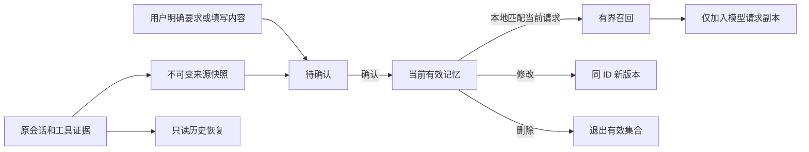

# DeskMate R1 / R2 / R3 学习记录

## R8-A：界面重构与业务契约

### 为什么没有重写 Agent 核心

这轮问题是信息密度、入口位置和展示状态，并非 Agent 的工具执行能力。`ChatWindow` 的导航只改变 `QStackedWidget` 的当前页；任务、记忆和通知仍提交既有命令。`Agent`、`Runtime`、`SessionService`、权限模块及三个 SQLite 业务存储未改变。这样才能用原有真实工具、实际写入与跨工作区测试证明功能仍然成立，而不是用一套新界面内的模拟状态替代业务事实。

唯一新增后台适配命令是 `artifact_preview`：核对当前工作区和已有成果路径，然后 `asyncio.to_thread(read_artifact, ...)` 读取受限 UTF-8 内容。结果是带命令 token / workspace 的展示数据；没有进入 Agent Loop，也没有更改 artifact 的 verified、执行状态、核对标记或权限规则。点击查看当前磁盘内容不能当成新一次证据核验。

### Qt 与后台如何解耦

Qt 主线程持有 `ChatWindow`、页面、字体和定时器，只读分离后的 snapshot 并提交命令。`DesktopController` 的 asyncio 线程持有 Runtime、SessionService、SQLite 和唯一执行消费者。页面之间共享同一个控制器，没有每页创建一次模型或事件消费者。

原 modeless 管理类名称和选择 API 保留，但嵌入内容必须使用实际 QWidget。初版直接给 QDialog 设置 Widget flags，回归观察到隐藏/恢复期间旧页面可见和焦点丢失；最终通过 `Page(QWidget)`、单一可见页约束和通知恢复后的延迟聚焦解决。聚焦前再次核对当前页、窗口可见性及同一 request_id，避免用户已经换页或请求已过期时抢回焦点。Qt 6.8 的兼容激活调用仍有弃用警告，升级 Qt 时需要重新验证替代 API。

R8-A.1 专项补记：Qt 6.8 官方建议用 [QWidget.activateWindow 替代 setActiveWindow](https://doc.qt.io/qt-6.8/qapplication-obsolete.html)，但它与内部激活状态设置不应仅按名称视为等价。2026-11-25 在独立测试进程中替换延迟回调的激活调用，原 8 项通知定位回归有 6 项通过、2 项隐藏恢复后的焦点断言失败。产品源码未采纳该候选，也未删除断言或放宽等待。当前用户暂缓原生人工验收，保留已有兼容调用及警告，把替代方案留待具备原生验证条件时处理。

### 如何保住草稿和原权限请求

页面切换不重新构造输入控件。对话发送记录命令 ID、编辑文档版本、工作区和原文，只有对应成功回执且内容未被编辑时才清空。工作区交接把旧聊天草稿放入按路径索引的进程内字典，过渡期显示空数据；新工作区不继承任务/记忆表单身份。退出不承诺保存未发送内容。

提交前复审还发现两段不同的交接窗口：旧 Runtime 正在释放而旧调度库仍可访问，以及后台已切换而 Qt 尚未刷新。前者需要调度命令核对就绪状态和存储工作区；后者需要 UI 命令携带实际展示的工作区，后台再次匹配。仅清空页面或依靠任务 UUID 无法保护不带既有 ID 的新对话、任务预览和偏好创建。新增测试控制真实异步释放，并暂停 Qt 轮询，分别证明旧安排不变、新工作区无新增数据且 fake client 未调用。

任务预览 token 保留原 ScheduleStore 验证与最终确认。表单变动使旧预览按钮失效；后台返回迟到预览时，对照提交时的表单快照，保留刚输入的新内容并要求重新预览。不能仅凭“收到了一个成功回执”覆盖当前编辑器。

提交前复审进一步复现连续两次预览的竞态：只有一份“最新表单快照”仍不足够，因为第一份响应可能正好与第二份提交时保存的表单匹配，进而覆盖编辑器。现在每次 UI 预览带独立 `preview_id`，响应身份与表单内容一起匹配；旧响应不能消费较新请求的快照。该字段只存在于控制器的临时预览，不改变 ScheduleStore 的保存 token、修订检查和权限范围。

成果读取同样需要显示身份。只核对 workspace 和路径列表无法区分“换文件”或“不同执行复用同一路径”；现在文件选择变化清除请求令牌，预览身份包含执行或会话/运行来源。读取仍须显式点击，不因切换自动执行；测试同时检查模型调用数为零、证据状态不提升，以及 NTFS junction / Linux 符号链接不能越界。

权限卡片仍通过 session/run/request 三重身份回复，按钮名字和实际协议保留。从通知导航只定位；批准/拒绝仍由原 `reply` 分支处理。用户可以在别页看到待处理入口，也可以通过通知直接回到原卡片；没有隐藏确认、自动同意或扩大文件/URL 范围。

### 普通状态与工程审计如何并存

`presentation.py` 只格式化状态、时间和成果文案。`verified` 显示已回读核对，`written` 显示待回读，`write_unverified` 显示需人工核对。时间和状态来自业务快照，不从模型回答推测。任务完成、文件存在和文件验证是不同事实。

`Disclosure` 把完整工具过程、JSON、来源和 run/request 标识收起。列表优先展示内容、时间、类型和需要用户处理的状态，查看技术详情仍能复核原记录。通知的稍后、关闭、取消本次和停止周期继续分开；停止整个安排增加非阻塞明确确认，并捕获当时的通知/任务版本。

聊天只在文本变化时更新；流式前缀不变时用 QTextCursor 追加，保留选择锚点和阅读滚动位置。来源详情在内容相同时不 setPlainText，避免轮询破坏复制。输入与展示文本不执行 HTML，不加载远程资源。

### 如何验证重构没有改坏业务

新增 `tests/test_desktop_ux.py` 覆盖页面切换时同一消费者和 pending request 不变、跨工作区草稿隔离、流式选择与滚动、编辑后重新预览、迟到预览不覆盖输入、真实成果预览不改证据或增加模型调用、越界/过大/二进制拒绝、窗口缩放和表单按钮可达。

原 R6/R7 GUI 测试继续核对真实 SQLite、权限回复、写入次数、未知写入和重启。三处显示适配保留业务断言：工具返回文字移到技术详情；零待处理数移到无障碍描述/提示；停止整个周期先检查确认前未变化，再点击确认后检查停用。没有减少测试、提高时限或增加 skip 来掩盖失败。

双平台完整离线结果、独立 SubAgent 90 项脚本、编译、入口帮助、锁文件与 Git 空白检查均记录在 verification.md。offscreen PNG 只证明实际 Qt 的渲染布局；Windows 可见采集超时和仍待用户评价的缩放/托盘/视觉效果单独记载。

### 五个对应实际代码的面试问题

1. `ChatWindow._select_page()` 为什么不能调用 controller 的 cancel/new？如何用同一个 `_consumer`、pending request 和写入计数证明导航没有副作用？
2. `ChatWindow.send()/refresh()` 为何同时记录命令 ID、文档 revision 和工作区？如果发送后用户继续输入，旧成功回执应该清空哪一份内容？
3. `ScheduleWindow.invalidate_preview()/form_values()` 如何处理“预览提交后用户又修改表单”的竞态？为什么只禁用一次按钮而不比较新 token 不够？
4. `ArtifactPreview` 与 `read_artifact()` 如何防止任意路径读取、远程资源加载和把当前文件内容误当作已验证历史？测试如何证明没有模型/工具重放？
5. 从 `NotificationWindow.action()` 到 `navigate_notification()` 再到原权限 `reply`，哪些检查由 UI 做、哪些必须由后台重新做？如何防止过期请求、跨工作区点击和停止下一周期的误操作？

## R7：通知状态、去重与重新核验

**为什么通知状态独立于任务状态？**“我看过了”和“事情办完了”不是同一个事实。提醒可以已查看但仍待处理；权限提示可以被关闭但请求仍在等待；运行可以 completed 却没有任何文件。把通知的 unread/viewed/snoozed/handled 放在独立记录，execution 继续负责 pending/awaiting_model/waiting/completed/interrupted，才能避免点击通知就完成任务、关气泡就批准工具这类错误。valid 是从业务事实推导的有效性，不拿它替代用户的阅读状态。

**如何在重复事件与重启下去重？**先给业务事件稳定身份，再保存发送进度。每个 execution 的模型确认/结束事件用 execution_id + kind；权限和问答用 run_id + request_id。一条执行遇两个权限请求就是两个决定，不能只用 task_id 或 execution_id 去重。SQLite UNIQUE 保证重复投影只有一条；业务写入事务提交前重建通知，同一事务失败则一起回滚。启动和扫描也可幂等补建，首次升级仅把旧完成提示置为已处理，仍保留需要用户决定的事项。稍后提醒增加代次并保存时间，已领取代次持久化，所以重启不会重复弹同一代，也不修改任务周期。

**为什么点击通知还要重新核验请求？**UI 快照是过去某个时刻的事实。用户看到提示后，权限可能已超时、执行可能已结束，甚至已换工作区。后台先匹配 workspace、通知 revision、execution，再匹配 session/run/request，并查询真实 Interaction Future 是否仍 pending；之后只导航。真正允许或回复时，原 reply 协议还会再核验一次。已结束的通知只能查看历史，未知写入仍须核对磁盘后明确发起新尝试，点击不能变成工具重放。

R7 保留单一 `_consume`：调度器与消费者写事实、NotificationLedger 投影及领取、Qt 主线程展示。通知领取结果必须与更新后的通知代次/有效性一起发布到同一个展示快照；若先发布“已领取”再发布新的 snooze 状态，Qt 可能把刚到期的提示当作仍延后而丢弃。端到端验收发现了这个竞态，已将 execution、通知、导航及领取结果相关字段合并发布。数据库原子提交和 UI 快照一致性是两个不同边界，两个都要照顾。

人工验收还发现，后台返回正确的 request 导航目标，不代表用户能看到权限卡片。Windows 的附属 QDialog 会留在主窗口上方；只隐藏通知中心再 raise 主窗口，先前的任务窗口仍可能挡住卡片。原测试帮助函数在允许模型后主动隐藏任务窗口，掩盖了这个问题。修复在有效请求导航时收起各附属窗口、保留草稿，再恢复主窗口并聚焦卡片；新增测试刻意保留任务和记忆窗口，检查实际可见性、异步焦点、草稿及重复点击的调用计数。原请求超时后仍按历史处理，修复窗口不能恢复旧授权。

七条可见验收给出了可对照的实例：关闭“静音提醒 A”后，通知为 handled，execution 仍 pending；取消一次执行后，周期的 enabled、revision 和 next_due 不变；停止整个周期后，enabled=0、next_due=NULL，旧历史保留。首轮导航排查时权限超过五分钟后结束，旧卡片没有恢复；修复后的新尝试使用新的 execution/run/request，必须再次明确允许。失败和未知写入的重复查看、四个会话恢复与最终重开前后，模型日志始终 19 行、写入日志 3 行，整体哈希和文件修改时间均相同。这些证据分别说明阅读状态与业务事实独立、旧通知不应重发或触发重试，以及导航和真正回复都需要核验当前请求。

系统气泡没有跨 SQLite 与 Windows 的原子确认协议。本实现选择先持久领取，再显示，避免重复弹窗；进程在两者之间退出可能少一次气泡，因此通知中心才是可靠入口。静音期间照常入库，解除静音时合并仍有效的事项；“最多一次领取”不应表述为“Windows 保证恰好显示一次”。[实现与可复现实验](deskmate-notifications.md)、`tests/test_notifications.py` 和 `tests/test_r7_acceptance.py` 分别覆盖存储边界与完整桌面流程。

本文记录本轮代码结构和可复现行为，不代写个人学习体会。路线与验证入口：[roadmap](deskmate-roadmap.md)、[verification](verification.md)。

前半部分保留 R1/R2 时点的学习材料；当前执行、会话与桌面线程模型见各轮记录及文末 R3，不能把 R1 的“两套循环仍独立”等描述当作当前实现。

### 提交前复审补充：状态与失败边界

通知状态与业务状态分开，还必须反映在按钮和后端判断上。复审发现，关闭本条通知后曾错误地同时禁用取消本次和停止周期；待处理提醒也漏了取消按钮。修复后，是否继续提示取决于 handled/snoozed，是否允许业务取消取决于 execution、task 和真实请求的有效性。用提醒/模型任务、先关闭/不关闭四种组合验收，并在下一周期出现后重放上一期的取消命令，核对新一期完全不变。

重新核验不能只放在点击入口。请求 Future 已结束而结果事件尚未消费时，数据库仍可能写着 active；迟到的首次请求事件也可能覆盖当前卡片。因此扫描与领取气泡前核验真实 Future，首次事件已过期则丢弃。不能仅凭最新 pending 卡片判断其他请求已结束。工作区切换也有过渡期：界面已经清空，旧库却还在释放中，所以命令必须同时检查展示工作区、存储工作区和控制器就绪状态。

去重还要覆盖失败事务。实际 SQLite 读锁可以令领取的 COMMIT 失败，测试必须核对代次和冷却时间都回滚，重试与重开后只领取一次。界面也要收到失败回执并清除等待令牌，否则存储虽然正确回滚，提示通道仍可能永久停住；一秒退避避免紧密重试。

权限回复有更直接的副作用边界：先完成 Future 再保存决定，可能出现“保存失败、界面拒绝，但文件已经写入”。现在先检查格式和真实 Future，在同一后台循环内同步提交决定，再回复，中间不让出执行权。保存失败时 Future 保持待处理；放行后单纯刷新失败不改变成功回执。保存的允许是用户决定的证据，不是恢复授权：如果进程恰在保存后、工具执行前退出，重开仍按原规则进入核对，不重放。

### 发布前失败补查：Qt 事件推进不等于后台线程推进

一次 Windows 完整回归在允许写入后等待 idle/completed 超过六秒，尽管隔离数据库最终保存了 completed、文件回读也一致。终态落库和界面发布 idle 是不同时间点，不能只凭磁盘事实宣布界面当时已完成；没有失败瞬间的快照也不能认定唯一原因。

共享测试等待器仅调用 `QTest.qWait`，可处理 Qt 事件却没有保证后台 Python 线程得到调度。对照探针延长解释器自动切换间隔，由 Qt 定时器开启后台线程的 gate：旧循环三次都已处理 Qt 事件却未让工作线程完成；每轮显式 `time.sleep(0.001)` 后，同一时限三次均完成。新增行为回归先证明旧等待器失败，再修复共享等待器；finally 恢复全局切换间隔并回收线程。原业务六秒时限、草稿/完成/回读断言均保留，没有通过放宽断言或增加跳过取得通过。具体失败与后续结果分别保留在验证记录中。

## 为什么从 TUI 中提取装配

重构前，`LikeCCApp._select_provider()` 和 `__main__._run_prompt()` 分别创建 client、权限检查器、基础工具、Agent 和委派管理器。新增桌面入口如果继续复制，会出现三份装配代码，权限规则路径、工作目录或关闭顺序容易发生偏差。

`Runtime` 现在只描述一个运行实例如何组装及释放公共对象。它不导入 Textual 或 LikeCCApp，不负责展示消息，也不替入口决定是否启用会话、记忆、Skills 或 MCP。测试在全新解释器里阻止所有 Textual 导入，仍能完成装配。

“装配共享”不等于“能力一致”。TUI 和非交互入口的输出、权限交互、扩展加载与执行循环仍按原方式工作。R1 为 R2 的服务迁移建立边界，没有提前实现 R2。

## 实际涉及的代码

| 文件 | 类 / 函数 | 本轮作用 |
| --- | --- | --- |
| `likecc/runtime.py` | `Runtime.__init__ / initialize / assemble_delegation / stop_background / aclose`、`finish_cleanup` | 公共装配、配置快照和生命周期契约 |
| `likecc/app.py` | `LikeCCApp._select_provider / _configure_interactive_runtime / _spawn_task / _close_resources / _serve_mcp` | TUI 适配及入口资源管理 |
| `likecc/__main__.py` | `main / _run_prompt / _run_prompt_with_hook_cleanup` | 显式传工作目录；接入共享层；保留非交互执行 |
| `likecc/client.py` | `LLMClient.aclose / resolve_context_window` | 释放主 client 与元数据查询临时 client |
| `likecc/agents/task_manager.py` | `TaskManager.shutdown` | 取消、等待及补全尚未开始执行的任务状态 |
| `likecc/teams/manager.py` | `TeamManager.__init__ / shutdown` | 注入实例名字注册表；等待队友退出 |
| `likecc/tools/agent_tool.py` | `AgentTool.aclose / _create_client_for_model / _bind_child_tools` | 子 client 归属、嵌套工具资源树和子 Agent 工具结果隔离 |
| `likecc/tools/send_message.py` | `SendMessageTool.execute` | 使用所属 TeamManager 的名字注册表 |
| `likecc/mcp/client.py`、`manager.py` | `connect / register_all_tools` | 初始化中取消也可清理；及时持有已创建 client |
| `tests/test_runtime_assembly.py` | 20 项参数展开后的测试 | 装配、隔离、入口能力、失败、取消、重复关闭和真实本地 MCP 生命周期 |

`likecc/agent.py` 的 `Agent.run()` 与 `run_to_completion()` 本轮没有修改。

## 调用关系：重构前后

重构前：

```text
main
 ├─ LikeCCApp._select_provider
 │   ├─ client + checker + registry + Agent
 │   ├─ Memory / Session / Skills / Worktree / 子 Agent / Team
 │   └─ Hook startup + MCP + UI
 └─ _run_prompt
     ├─ client + checker + registry + Agent（另一份创建代码）
     └─ Worktree / 子 Agent / Team
```

重构后：

```text
main（读取配置并捕获工作目录）
 ├─ LikeCCApp
 │   ├─ Runtime.initialize
 │   ├─ TUI 特有对象、命令和交互工具
 │   ├─ Runtime.assemble_delegation(interactive=True)
 │   ├─ Hook / MCP / 界面
 │   └─ Agent.run(conversation)
 └─ _run_prompt_with_hook_cleanup
     ├─ Hook startup
     ├─ Runtime.initialize(resolve_context=True)
     ├─ Runtime.assemble_delegation(interactive=False)
     ├─ Agent.run_to_completion(prompt, conversation)
     ├─ Runtime.aclose
     └─ Hook shutdown
```

两阶段装配让 TUI 在公共核心与委派能力之间注册自己的工具，保留原 schema 顺序和绑定关系。不要在第二阶段失败后忘记 `finally: await runtime.aclose()`。

## 初始化、执行、关闭分别由谁负责

初始化由 Runtime 创建公共依赖；入口创建其特有对象。`work_dir` 先解析为绝对路径，不通过修改进程 cwd 来切换工作区。WorktreeManager 的回调更新 Agent 工作目录和权限 sandbox，并清空对应工具缓存。

执行仍由入口驱动：TUI 消费 Agent 事件并响应用户确认；headless 收集结果、打印文本并跟进后台通知。会话对象及恢复流程仍由入口负责。

TUI 关闭时，先停止界面计时器并取消、等待入口协程，再停止共享运行时的子任务；随后清理 Hook/MCP，正常 Ctrl+C 退出时尝试记忆提取；最终关闭会话文件及 Runtime client。强制退出、初始化失败或 Textual 测试卸载，也进入同一个幂等关闭入口。

非交互入口在 `finally` 中关闭 Runtime，外层在同一事件循环中关闭 Hook。Runtime 借用 HookEngine，不重复执行 startup/shutdown。临时元数据 client 和记忆召回 client 由创建它们的局部查询负责关闭。

`cancel()` 只是发出取消请求；`await` 或 `gather()` 才能确保任务的 `finally` 已执行。共享清理任务配合 `asyncio.shield()`，让取消等待者不会把资源释放一起中断；同一个关闭任务被多次等待，不重复关闭资源。

## 一个测试构造的失败案例

`test_tui_extension_failure_closes_session_and_core` 将 `SkillLoader.load_all()` 替换成抛出 `RuntimeError("skills failed")` 的函数。

当异常出现时，主 client、Agent、MemoryManager、Session 文件和窗口查询任务已创建。`_select_provider()` 捕获该装配异常，调用 `_close_resources(run_shutdown_hook=False)`；窗口查询被取消并等待，会话文件关闭，Runtime 关闭 client，然后原异常继续向上传播。

测试断言会话文件已关闭、fake client 关闭次数为 1；随后再调用 `on_unmount()`，关闭次数仍为 1。这同时验证部分初始化回滚和幂等关闭，而不是检查源码中是否出现某个 `finally` 字符串。

另一个案例 `test_cancelled_and_concurrent_close_waits_for_resource_finalizer` 用事件阻塞 fake client 的关闭。连续两次取消等待者，资源释放仍会等到测试解除阻塞；其他关闭调用也能等待同一次清理完成。最后取消才传播回调用者。

## 对应代码的面试问答

**1. 为什么共享层既不接收 LikeCCApp，也不创建 Textual 组件？**

它依赖的是配置、路径和核心对象。UI 反向依赖 Runtime，后续桌面入口才能复用同一装配。`test_runtime_assembles_with_textual_imports_blocked` 用导入阻断验证这条边界。

**2. 工厂函数只返回 Agent 够不够？**

这里不够。Agent 背后还连接主/子 client、后台 TaskManager 和 TeamManager。只返回 Agent 会隐藏需要关闭的对象。Runtime 同时作为这些对象的持有者，公开 `stop_background()` 与 `aclose()`；入口仍对自己的会话和 MCP 负责。

**3. 为什么取消任务后还要 gather？**

因为任务尚需运行清理逻辑，直接关闭模型连接可能打断子 Agent 的 finalizer。`TaskManager.shutdown()` 等待所有任务，且处理尚未得到第一次调度的任务：这类任务不会进入协程内的 `try/finally`，需补记 cancelled 状态。

**4. 实例隔离是把所有数据复制一份吗？**

不是。配置、Provider 窗口缓存、工具发现状态、文件缓存、权限状态、任务队列和名字解析表需要独立；已有用户记忆和持久团队文件仍按原路径共享。`test_runtime_instances_isolate_config_tools_permissions_and_disk_results` 还用相同 tool-use ID 验证两个实例的结果文件不会覆盖或读到彼此内容。

**5. 为什么 MCP 需要专门的生命周期协程？**

其底层包含 AnyIO 异步上下文和取消作用域。连接和退出上下文应在同一任务中配对。`_serve_mcp()` 持有连接直到收到停止信号，在 `finally` 里关闭；入口只等待就绪或请求停止。测试既记录 fake MCP 连接/关闭时的任务身份，也启动本地真实 stdio 服务验证退出后的连接状态。

## 可以亲手验证的小实验

目标：观察“取消等待者”与“资源释放完成”是两个事件，不需要模型 Key。

在 WSL2 终端执行：

```bash
source /home/ldj/anaconda3/etc/profile.d/conda.sh
conda activate cc
cd /mnt/d/ldj/03/DeskMate
python -m pytest -q -o cache_dir=/tmp/deskmate-r1-pytest-cache \
  tests/test_runtime_assembly.py::test_cancelled_and_concurrent_close_waits_for_resource_finalizer
```

打开该测试，找出 `started`、`release` 两个事件以及两次 `close.cancel()`：前者表示已经开始释放资源，后者控制释放完成。在 `release.set()` 前后临时打印 `close.done()` 和 `client.closed`，加 `-s` 再运行；检查解除阻塞前关闭等待尚未完成，结束后 client 只关闭一次。打印结果受协程调度时点影响，应以测试中的同步点和断言为准。实验结束删除临时打印，再运行该用例。

进一步可运行整个 `tests/test_runtime_assembly.py`，其中所有模型回复都是 fake；本地 MCP 用例只启动临时 Python stdio 服务。测试通过不能推导真实模型效果、桌面交互质量或性能指标。

## R2 学习记录：从共享装配到共享执行

### 1. 初始化共享并不等于执行共享

R1 的 Runtime 让两个入口获得同样的 client、权限检查器和 Agent，但 Agent 里仍有两套完整循环。修复一条循环的 thinking、压缩或取消，并不会自动修复另一条。R2 在 `agent.py` 的 `_run_loop()` 保留一个执行内核：`run()` 产生事件，`run_to_completion()` 消费相同事件。完整结果只使用 `LoopComplete.result`，不会把“准备调用工具”混进最终答案。

### 2. 谁负责哪一段

| 阶段 | 代码 | 责任 |
| --- | --- | --- |
| 装配 | `runtime.py: Runtime.initialize / assemble_delegation` | 显式配置/目录、模型与工具、委派资源 |
| 可选扩展 | `extensions.py: RuntimeExtensions.initialize` | 显式启用 Skills、MCP、Hook、交互工具；关闭已获取资源 |
| 准备会话 | `service.py: SessionService.new_session / resume / _execute` | 历史、记忆召回、加入一次输入、持久化 |
| 执行 | `agent.py: Agent._run_loop` | 模型→工具→结果回填→下一轮；不管理用户会话文件 |
| 展示和回复 | `app.py: LikeCCApp._send_message / on_inline_permission_widget_responded` | 展示事件，通过 run_id/request_id 提交决定 |
| 收尾 | `RunHandle.cancel / SessionService.aclose / Runtime.aclose` | 当前运行→服务任务/会话→子任务/团队→扩展→client |

`SessionService` 借用 Runtime 的 Agent/client；Runtime 持有服务并负责总关闭。单独关闭服务不关闭模型或委派资源；单独取消运行也不会停止用户明确允许的后台工作。

### 3. 一次输入的调用关系

R1（历史）：

```text
TUI._send_message → 在 UI 中追加/召回/保存 → Agent.run → 第一套模型/工具循环
CLI._run_prompt → Agent.run_to_completion → 第二套模型/工具循环
```

R2（当前）：

```text
TUI._send_message ─→ SessionService.start(interactive=True) ─┐
CLI._run_prompt ──→ SessionService.run_to_completion() ─────┤
                                                        ↓
             准备上下文 → 保存输入一次 → Agent.run → _run_loop
                                                        ↓
             工具结果/状态落盘 ← RunEvent ← AgentEvent
                                       ↓
                       TUI 展示 / CLI 返回最终结果

内部子 Agent → Agent.run_to_completion → Agent.run → 同一个 _run_loop
```

会话服务给事件加 `run_id`、`session_id`，没有另造一套工具/文本事件。`RunEvent.to_dict()` 展开 dataclass，输出可以 `json.dumps()`。服务等到持久化和交互清理完成才发布唯一终止事件，状态与 `RunHandle.status` 一致。

### 4. 权限请求怎样避免等待环

`interaction.py: Interaction.request()` 在执行任务内登记私有 Future。执行器先 yield `PermissionRequest`，服务将其放到事件队列，UI 或其他消费者因此能继续运行。消费者调用 `run.reply(run_id, request_id, "allow")`，Interaction 检查标识和是否已经回复后才完成等待。

批准才执行工具；拒绝返回可恢复工具错误；没有 handler 立即拒绝；handler 没回复默认 300 秒后拒绝。等待时取消会注销请求；之后的旧回复返回 False。AskUser 走相同请求/回复结构，但回复内容是 `{问题name: 答案}`。

低层 `Agent.run()` 需要显式 `interaction=Interaction()` 才允许交互。TUI/CLI 推荐调用服务，避免直接管理权限对象。`PermissionResponse` 仍可从 agent 模块导入，`PermissionRequest.future` 已被移除。

### 5. 取消不等于撤销

`RunHandle.cancel()` 请求停止并等待 worker 收尾。仍有效的订阅先获得 `LoopComplete(status="cancelled")`，随后 `events()` / `result()` 抛出 `CancelledError`。提前关闭消费者应配合 `async with run` 或 `aclosing(run.events())`，让 Python 明确执行 finally，不能仅丢弃一个未关闭的生成器。

WSL/POSIX 的 Bash 会结束进程组，模型流关闭；已经写入的文件仍可能存在。若一个批次部分工具完成、部分被取消，服务保留已观察的结果，为其余调用补“结果未知”的错误记录。恢复时应检查真实外部状态，不能假定失败意味着无副作用。

### 6. 会话恢复和持久任务恢复

`SessionManager.resume()` 读取 JSONL、找最近 compact boundary、过滤不完整工具尾部；`SessionService.resume()` 加载一次历史、重新绑定 FileHistory，必要时追加修复边界。`run_state` 记录成功/失败/取消用于审计，不是等待队列。

它不会重新启动进程、重建权限 Future 或自动重做工具。R5 的持久任务/调度仍未实现。服务只提供同进程会话独占和同会话一次运行；跨进程写入、外部副作用事务和重启恢复待授权操作均不支持。

环境、长期记忆封装、MCP 提示与召回用 `Message.transient` 标识，服务保存时排除；下一次召回替换上一条。用户输入、模型消息和工具结果按对象身份只保存一次。普通重复 resume 不向文件重复追加历史。

会话隔离还包括切换后的内存状态。`SessionService._bind_session()` 调用 `Agent.reset_session_context()` 清理工具发现、激活 Skills、文件缓存及压缩恢复状态，并更换工具结果子目录。保留 Runtime 的权限模式、工具启用配置和独立后台任务；恢复时保留磁盘会话的累计 token 基线。

### 7. 一个实际测试构造的失败案例

`tests/test_session_service.py::test_permission_cancel_emits_terminal_and_repairs_tool_chain` 用 fake 模型提出写入，在 PermissionRequest 到达后取消。断言工具执行次数为零、旧回复无效、请求数归零、终止状态为 cancelled；恢复后的工具调用与错误结果对应，JSONL 不是 completed。

这是构造测试，不是真实模型事故。开发过程中实际遇到的回归是：初版完整结果适配在看到 failed 终止事件时提前抛出通用 RuntimeError，覆盖了模型原异常。修复为先消费完共同事件流，再处理正常结束的失败状态，保留模型原异常；原 `test_document_headless` 失败清理断言没有被削弱。

实际 TUI 测试还发现旧 AskUser 的等待环、富文本解析和答案标识问题。`tests/test_entry_service.py` 现在通过 Textual 测试环境实际键入 `yes` 并确认，验证工具收到 `answer: yes`。这不等于真实桌面 GUI 验收。

### 8. 五个面试问题与参考回答

1. **为什么不让 run_to_completion 再实现一个 while 循环？** 两份模型/工具循环会发生行为漂移。当前它消费 `Agent.run()`，通过终止事件取答案；上下文、Hook、工具和失败处理只有 `_run_loop()` 一份。
2. **为什么不能把 Future 放进服务事件给界面？** Future 绑定事件循环，无法作为普通消息序列化，且界面可能越过关联校验直接授权。当前 Future 留在 Interaction 内，外部使用一次性的 run_id/request_id 回复。
3. **怎样保证同一个输入不会保存两次？** 入口只提交字符串；`SessionService._execute()` 追加，`_flush()` 记住已保存消息身份并排除 transient。TUI 不再自己 append；普通 resume 标记已有历史为已保存。
4. **CancelledError 和工具错误为何不能一视同仁？** 工具错误可以回填给模型继续推理；取消表示整个运行终止。服务先清理请求和修复记录，再对结果调用者传播 CancelledError；不使用正常答案掩盖取消。
5. **为什么 Runtime 与服务不能都关闭 MCP/Hook？** 重复关闭会破坏异步资源上下文。RuntimeExtensions 独占 MCP 任务，连接与退出在同一协程；借入 Hook 归入口，自建 Hook 归扩展，构造时拒绝同时接管。

### 9. 两个可亲手运行的实验

先在 WSL 进入开发目录并激活用户指定环境：

```bash
source /home/ldj/anaconda3/etc/profile.d/conda.sh
conda activate cc
cd /mnt/d/ldj/03/DeskMate
```

**实验一：同一个假模型，批准和拒绝会改变什么？**

```bash
python -m examples.deskmate_session --decision allow
python -m examples.deskmate_session --decision deny
```

观察 PermissionRequest 与 ToolResultEvent。批准打印 `file_created=True`，拒绝为 False；二者最终均可 completed，因为工具拒绝是可恢复错误。两次都打印 `user_input_count=1`、`repeated_resume_unchanged=True`。演示使用 fake client、临时 HOME/工作区，不读取真实 Key；退出会删除临时目录。

**实验二：在权限等待时取消，再恢复会话。**

```bash
python -m examples.deskmate_session --decision cancel
PYTHONUTF8=1 python -m pytest -q -o cache_dir=/tmp/deskmate-r2-pytest-cache \
  tests/test_session_service.py::test_permission_cancel_emits_terminal_and_repairs_tool_chain
```

观察 cancelled 终止事件、取消传播提示、文件不存在和重复恢复不变。打开对应测试查看 run_state、工具关联 ID 和旧回复 False 的断言。若要观察原语控制流，再看 `tests/test_execution_contract.py::test_permission_wait_cancellation_invalidates_request`；这些都是离线构造案例，不能推断真实模型效果或性能。

### 10. R3 调用者的最小约定

```python
# runtime 已 initialize；service 已按需要启用 persistent/memory。
try:
    async with service.start("用户输入", interactive=True) as run:
        async for envelope in run.events():
            data = envelope.to_dict()  # 交给展示适配器
            # 收到权限/问答事件后，由外部提交 run.reply(...)
    answer = await run.result()
finally:
    await runtime.aclose()
```

不要从两个窗口同时调用同一个服务；重叠请求会被拒绝。桌面入口需要选择自己的线程与事件消费策略，及时消费单订阅队列；当前没有网络协议、跨线程投递、持久权限队列或自动重试副作用。

## R3 学习记录：窗口外的应用生命周期

R2 已提交到 `7f09816729ca63717b050f0cd9690c79049d456e`。本节对应其后的 R3 未提交工作区，R1/R2 前文保留各轮历史含义。

### 三个执行位置与所有权

| 位置 | 当前代码 | 负责对象 |
| --- | --- | --- |
| Qt 主线程 | `desktop/window.py: ChatWindow`；`desktop/application.py: DesktopApplication` | 控件、托盘、定时拉取展示快照和关闭选择 |
| 专用 Python 工作线程 | `desktop/controller.py: DesktopController._thread_main / _lifetime` | 长期 asyncio loop、Runtime 和 SessionService 生命周期 |
| 工作线程中的异步任务 | `_dispatch / _consume`，R2 Agent/RunHandle/Interaction | 模型与工具、唯一事件消费、权限回复与取消 |

线程是非 daemon 的 threading.Thread；asyncio.run 只在这个线程使用。不是把一个方法放进 QThread 子类就假定它在后台，也没有引入第二个 Qt/asyncio 整合框架。

### 点击发送到保存与展示

```text
Qt 按钮 → DesktopController.submit('send', text=...)
       → loop.call_soon_threadsafe → _dispatch
       → SessionService.start(interactive=True) → Agent 共享执行内核
       → 用户输入和工具链保存 → RunHandle.events（_consume 唯一订阅）
       → RunEvent.to_dict → _event → 有界展示模型
       → Qt 主线程 QTimer 拉取 snapshot 副本 → ChatWindow.refresh

权限按钮 → submit('reply', session_id/run_id/request_id/value)
         → _dispatch 校验 → 后台 run.reply → 后端接受结果 → GUI 确认
```

所有 Runtime、client 和 Future 在所属后台循环内创建、使用和关闭。界面没有拿到 RunHandle、没有调用 Future.result()、没有长时间 join 或网络调用。问答按 schema 的 name 取值；权限默认只给当前请求批准或拒绝。

### UI 解耦不自动意味着线程安全

R2 事件没有 Textual 对象，解决了界面耦合，但 asyncio.Future/Queue/Task 仍归某个 loop 所有。若 Qt 按钮直接调用 run.reply 或 Task.cancel，仍可能跨线程操作。

当前 submit 使用 call_soon_threadsafe，返回命令 ID；真正的回复/取消发生在后台。GUI 拉取 snapshot 时只得到 deepcopy 的普通数据，修改它不会改变后端。`tests/test_desktop_controller.py::test_worker_owns_resources_and_demo_uses_real_service` 记录创建、运行、回复和关闭的线程 ID/loop ID；GUI 测试另外约束 refresh 在主线程执行。

### 为什么消费者属于应用

R2 的事件流只允许一个消费者，关闭消费者会取消运行。如果每次打开窗口重新订阅，就可能取消旧请求或重复执行工具。当前 DesktopController 的 _consume 与窗口是否可见无关；窗口只显示已有快照，新建/恢复才调用服务的会话 API。

文本连续增量合并，GUI 以 50ms 定时刷新，不产生每 token 一个 Qt 更新。缓存有条数和字符限额，截断可见；待回复请求独立保存。工具、请求、错误、结束仍按后台消费顺序处理，普通历史和完整工具结果没有被展示截断改写。R2 内部队列仍未设置硬上限，这是明确保留的限制。

### 隐藏、取消、退出是不同操作

- 隐藏：窗口不可见，控制器、运行和唯一消费者继续。有托盘才允许默认隐藏；无托盘时提供最小化/退出/取消，避免无法找回。
- 取消：RunHandle.cancel 清理本次等待/执行，运行以 cancelled 收尾，可以继续下一次输入；既有文件修改不会因此撤销。
- 退出：进入 closing，拒绝迟到命令，Runtime.aclose 清理资源树，再等待 loop/工作线程结束，最后退出 Qt。慢关闭会显示仍在等待，不用 daemon、terminate 或 os._exit 伪装完成。

`tests/test_desktop_lifecycle.py` 测试托盘存在/消失、无托盘关闭选择、重复退出、权限等待时退出与慢关闭。实际 WSLg 没有托盘，存在托盘的策略通过 FakeTray 测试，不能称为实际 Windows 托盘验证。

### R2 遗留边界：父进程退出不代表管道已结束

真实构造命令 `sleep 30 & echo $! > child.pid`：shell 很快退出并有 returncode=0，但 sleep 继承输出管道，communicate 仍会等待 EOF。R2 terminate 只在 returncode is None 时清理，因此超时和取消都会遗留 sleep。

R3 的 `tools/bash.py: _terminate_owned_process()` 对自己以 start_new_session 启动的 POSIX 进程组发送信号，无论 shell 是否已退出；然后等待进程并收回输出传输。进程已不存在时忽略 ProcessLookupError，允许重复调用。没有向任意系统进程组发信号。

`tests/test_bash_process_group.py` 先同步确认 pid 文件已生成、shell 已退出但工具未结束，再触发超时/取消，检测子进程停止；finally 清理自己的进程组。修复前两个回归失败，修复后通过。这是实际本机复现，不是性能实验或用户事故。Windows 和主动脱离进程组的子程序仍有边界。

### 三种桌面证据不能混用

1. offscreen Qt 自动化：实际创建控件，点击按钮、输入答案并验证调用链；没有实际桌面窗口或托盘。
2. WSLg Wayland 本机窗口：本轮实际显示窗口并截图，权限卡片可见、正常退出；托盘检测为 False。还不能据此认定人工完整使用流程已经验收。
3. Windows 原生 Python/托盘：本轮没有执行。WSLg 窗口出现在 Windows 桌面，不表示 Windows 进程树、托盘或打包兼容已验证。

### 五个面试问答

1. **怎样证明资源真的在后台线程？** Runtime 工厂在 _open 中调用，而 _open 在工作 loop 的任务中执行。测试记录构造、run、reply、close 的线程/loop 标识一致，且不同于 GUI 线程；不是仅凭类名判断。
2. **为什么一个长期 loop 优于每个按钮 asyncio.run？** 模型客户端、交互 Future 和 SessionService 的归属稳定；同一次运行的批准/取消不会落到已经结束或另一个 loop。当前只有线程入口使用 asyncio.run。
3. **权限等待为什么不会堵住按钮回复？** send 只创建运行与独立消费者，不等待整次执行结束才释放命令通道。reply/cancel 是另外的后台任务，能完成原运行正在等待的 Future。
4. **怎样避免 token 更新把 GUI 消息队列撑大？** 后台合并文本到受限展示模型，Qt 定时读取快照，不逐 token 发 Qt 消息。超限有提示；该机制不是服务持久化截断，也不承诺所有内部队列已有硬上限。
5. **为何父 shell returncode 不足以判断退出完成？** 它只描述一个进程；子进程可能持有 stdout/stderr，管道仍未 EOF。当前 POSIX 回收自己的进程组并收回传输，测试分别验证父退出、子停止与管道结束。

### 两个手动小实验

先在 WSL 激活 cc 并进入开发目录。

```bash
source /home/ldj/anaconda3/etc/profile.d/conda.sh
conda activate cc
cd /mnt/d/ldj/03/DeskMate
python -m likecc.desktop --demo
```

**实验一：允许、拒绝、等待与取消。** 发送任务，第一次拒绝写入；问答选择完成。新建会话再批准，通过界面工作区路径检查 demo.txt。问答选择等待取消，观察界面仍能点击；有托盘时隐藏再恢复，确认仍是同一运行。点击取消后再次发送，检查没有卡片残留。关闭应用后临时目录会删除。无托盘时使用最小化，不强行隐藏。该实验的完整人工结果尚待用户验收。

**实验二：父退出与后台 sleep。** 不自行留下 sleep，直接运行有 finally 清理的回归：

```bash
PYTHONUTF8=1 python -m pytest -q -s -o cache_dir=/tmp/deskmate-r3-pytest-cache tests/test_bash_process_group.py
```

阅读测试中的同步条件，确认 shell returncode=0 时 task 尚未结束；再看 _terminate_owned_process 去掉 returncode 条件的原因。可在本地临时打印父/子状态观察，不必修改已提交基线；实验后去掉打印。测试构造和真实模型效果无关。

更多启动选项、已验证/待验收范围见 [桌面说明](deskmate-desktop.md)。R4 的个人事务能力尚未开始。

## R3.1：异常安全与状态一致性学习记录

实际基线为 R3 `b1d44a1ae6e09f009ac01260712a5dc508e0fd7b`。下面按阶段保留测试构造、程序化观察和人工验收记录。真实 Provider 在最初修复阶段尚未验收，后续 DeepSeek 和 Windows 离线托盘结果见后文。

### 正常路径不能代表所有资源生命周期

R3 的 DesktopApplication.poll() 会在正常退出时等待后台线程，再退出 Qt，所以已有正常退出测试能通过。但 launch 在这个对象构造之前就创建了非 daemon 控制器；若对象构造失败，poll 根本没有机会运行。exec 提前返回、信号注册部分失败也会绕过正常路径。

`desktop/application.py: launch()` 现在持有从创建成功到退出的控制器所有权。`desktop/controller.py: request_close()` 是非阻塞关闭请求；`wait_closed(timeout)` 是 Qt 未运行/已结束后的有限等待，不关闭别人的资源，也不适合放进仍在运行的 GUI 按钮回调。Runtime、交互和唯一消费者仍在原 asyncio 线程中清理，主线程只等待线程结束。

清理本身也会失败。launch 记录进入 finally 时的原异常，逐项尝试关闭、Qt 展示释放和信号恢复；有原异常则保留它并用 add_note 附加诊断。没有原异常且清理不完整时不能以正常退出码伪装成功。仅恢复确实注册成功的信号处理器，避免部分初始化后错误地恢复未取得的资源。

`tests/test_desktop_launch.py` 使用真实控制器与 Qt 对象，并区分两类证据：替换 exec/构造器的纯控制流故障注入，以及实际运行 Qt exec 的正常退出。断言线程退出、client 单次关闭、会话文件关闭和信号恢复；不是只断言 mock 被调用。

### 三种状态怎样对齐

模型是否执行、是否仍需用户回复、UI 展示状态是三件不同的事。权限/问答超时后，工具已经收到错误结果，下一轮模型可能继续运行，此时 pending 应为空，展示应为 running；不能还说“等待回复”。

`DesktopController._event()` 先校验事件属于当前 session/run，再用 tool_id 找到应结束的请求。只移除这个请求；最后一个交互结束、运行仍活动且状态正是 waiting 时，在同一锁内更新 pending 和 running。若已处于 cancelling/closing/终态，工具结果只能作为结果展示，不能把状态倒退成 running。

`tests/test_desktop_wait_state.py::test_timeout_returns_to_running_while_next_model_call_is_blocked` 用明确事件确认下一模型调用已进入，再检查工具错误已经投影。权限与问答两条路径在 R3 基线都失败，本轮修复后通过；没有真实模型或 SDK 导入占位。另有线事件注入测试覆盖不相关工具、旧会话/运行及迟到结果；这类注入不表示内核已经支持多个并发人工审批。

### 三种所有权仍然不同

隐藏只改变窗口可见性，事件消费者仍属于应用控制器；取消只结束当前 RunHandle；退出才请求 Runtime 资源树结束。launch 的兜底补齐异常路径，没有把每次隐藏都变成关闭，也没有把等待线程放进活跃 Qt 槽函数。

### 各种证据分别能证明什么

- 单元/集成测试：明确的状态转换、关联拒绝、线程与资源关闭契约，使用 fake client 不产生模型费用。
- Qt offscreen：实际控件和 Qt exec 的行为，不能证明用户能从真实桌面找回最小化窗口。
- WSLg 可见窗口：程序化观察确认 Wayland 窗口显示并正常退出；随后用户亲自完成无托盘离线点击清单，确认最小化找回、取消/超时后重用、恢复历史不改写文件，以及两次正常退出清理。用户反馈与截图不等同于真实 Provider 验证。
- 真实托盘：本机仍不可用，模拟托盘测试只证明策略，不能写成真实通过。
- 真实 Provider：必须由用户手动或另行授权调用，才能证明现有凭据/服务及实际模型工具行为；修复与离线阶段未执行，后续 DeepSeek 指定验收的实际结果见下文。

### 用户离线人工验收补记（2026-11-17）

用户按桌面说明逐项执行并确认通过；没有记录用户的学习感受。实际现象对应三种不同职责：`DesktopController._event()` 投影交互结束，`DesktopController._dispatch()` 接受取消后的新任务以及新建/恢复会话，`DesktopApplication.apply_close_choice()` 区分取消关闭、最小化与退出。恢复前后的文件哈希、修改时间和大小由用户执行命令比较并反馈一致；正常演示和短超时演示均确认退出码 0、所记录 PID/线程结束和临时目录清理。

超时截图显示工具拒绝/问答超时后运行 completed，第二次发送结束后顶部为就绪且无卡片。这证明用户所操作离线流程的收尾与重用；下一模型调用被阻塞时是否恢复 running，仍以同步屏障测试为证，不能从最终截图推断完整时序。离线验收当时尚未做真实服务，后续 DeepSeek 单独验证；真实托盘、原生 Windows、安装继续未验收。

### 真实服务验收前的边界检查

2026-11-17 的静态检查没有找到当前 WSL 标准位置的 Provider 配置，因此还没有服务请求。fake client 可以证明交互协议、取消和生命周期，不能证明凭据有效、网络可达、模型支持工具，或模型正确读取文件；配置可解析与凭据“存在”也不能代替真实调用。

桌面当前在 `DesktopController._open()` 显式使用 DEFAULT，再由 PermissionChecker 与规则决定结果；本次预判为读放行、写询问。验收应核对实际判定及其原因，不能为了出现卡片切换到不符合既有语义的模式。PathSandbox 还允许系统临时根，Bash 另受命令权限控制，所以“只在验收目录工作”的提示词不等于强隔离；应在实际启动时把临时根留在验收目录、拒绝外部命令，并停止核查额外工具请求。

实际托盘探测 False 只说明当前 Wayland 环境没有可用托盘，模拟探测 True 的测试只能证明分支策略。WSLg 的 Python、HOME、路径和 POSIX 进程组均属于 Linux；Windows 原生环境、配置目录、默认 shell 和子进程回收需单独验证。桌面说明已列后续检查，本次不据 WSLg 成功声明 Windows 或安装包通过。

### 真实模型文字确认与工具权限的区别

本次 DeepSeek 集成任务先成功 ReadFile，再输出 summary.md 草稿并用文字问是否批准，当前回合 completed。会话审计只有一次 ReadFile，没有 WriteFile，实际 summary.md 不存在。这说明模型自然语言计划、服务的单次运行完成、权限系统的实际写入审批是不同阶段；不能看到草稿或 completed 就判断文件已经生成，也不能因为没有卡片就认定桌面绕过了权限。

离线 DemoClient 的预设步骤总会发出 WriteFile，真实模型则可能先向用户确认内容。正确验收是继续同一任务，让模型实际发出 WriteFile，再由现有 DEFAULT/规则与桌面交互决定是否执行，不用改 UI 或放松权限来制造卡片。首次回合只确认读取，后续写入与恢复的结果分别记录如下。

后续用户确认草稿后，真实 WriteFile 卡片出现并获批；实际 summary.md 与工具参数完全一致，ReadFile/WriteFile 各一条成功调用记录，源文件哈希未变。这个闭环同时核对模型意图、权限交互、工具结果和磁盘副作用，比只看“写入成功”文字更完整。退出恢复仍需单独验证：真实模式工作区由验收流程持有，应用只关闭 Runtime/会话资源，不像 demo 那样删除临时目录，否则无法重开恢复。

本次随后完成了真实退出重开与恢复：用户确认原会话历史/状态正确，实际文件哈希、修改时间、大小和工具计数均未变，原 assistant 仍五条、标记回复一次，新空白会话没有模型或工具记录。这个证据证明当前恢复展示不重放工具，不能据此推断“恢复后所有模型续聊均兼容”；本轮没有为该额外范围再发送付费请求。

最终第二次退出也由用户确认返回 0，自动核查新 PID 消失、原会话及文件基线保留，真实验收收尾完成。当前可以建议在 WSLg 无托盘范围进入 R4，仍不把模拟托盘或 WSLg 结果推广成原生 Windows/安装包保证；本轮不开始 R4，也不把 assistant 条数或预估费用当成平台实际账单。

### 三个面试问答

1. **为什么 finally 只恢复信号还不够？** 因为控制器线程在信号和窗口构造前就已启动。当前 launch 的 try/finally 覆盖所有成功取得控制器后的退出路径，收尾还包括公开关闭/等待接口、Qt 对象释放与部分信号恢复。
2. **为什么不能每个工具结果都设 running？** 无关工具可能不是等待请求的来源，取消/关闭也可能已经开始。当前用 session/run/tool 关联清理，并且只允许 waiting→running，不覆盖更后面的状态。
3. **有限 join 会不会冻住正常界面？** 正常界面通过 request_close 与 poll 异步等待。wait_closed 仅在 Qt exec 尚未运行或已经返回/抛错后调用。实际 Qt 测试在 exec 内标记活动区间，断言兜底等待不发生在该区间；超时明确报告而不强杀。

### 一个可亲手执行的实验

在 WSL2 激活 cc 后执行：

```bash
cd /mnt/d/ldj/03/DeskMate
PYTHONUTF8=1 QT_QPA_PLATFORM=offscreen python -m pytest -q --tb=short \
  -o cache_dir=/tmp/deskmate-r31-pytest-cache \
  tests/test_desktop_wait_state.py tests/test_desktop_launch.py
```

阅读超时测试中的 next_call 和 finalized：前者证明后台已经进入下一次模型调用，后者证明取消清理完成。再阅读 launch 故障注入中的原异常对象与 client/session/线程断言，观察“函数抛出”和“资源清理完成”为什么要分别验证。命令属于自动化实验；如要人工看窗口和超时卡片，使用桌面说明里的可见窗口命令，不能把 offscreen 当桌面验收。

### Windows 原生环境准备中的实际发现（2026-11-18）

独立 Windows `.venv-win-r31` 使用原生 Python 3.12.7 和锁定 PySide6 6.8.3；WSL cc 继续保持原样。同一份代码的托盘探测从 WSLg 的 False 变成 Windows 的 True，说明必须按实际桌面会话区分支持证据。True 仍只表示托盘服务存在，人工图标、菜单和退出验收尚未完成。

原生五个桌面测试文件出现 39 passed、2 failed。`test_desktop_window.py` 对所有 socket.connect 抛错以禁止演示联网，但 Windows asyncio 的 `_make_self_pipe` 使用 `socket._fallback_socketpair` 建立本机回环连接。实际调用栈已证明这个拦截先破坏了事件循环初始化；失败不能直接解释为模型联网，也不能直接忽略为通过。

后续修复测试时应区分解释器内部通信和业务网络请求，同时保留对外部连接的验证。本次没有改弱断言或调整产品事件循环，保留两项失败。独立 demo 控制器的 idle、线程退出和临时目录清理另行验证通过，只支持继续小范围人工检查，不能推广为 Windows 全平台测试通过。

### 改用 Windows Conda 时如何保持依赖可复核（2026-11-18）

当前原生验收改用 deskmate-win，旧 `.venv-win-r31` 与 WSL cc 保留。Conda 管理 Python 和运行库；uv export 从项目 uv.lock 导出带哈希的 desktop/dev requirements，uv pip install 显式指定 Conda 的 python.exe 安装。这样不会误选项目旧 venv，也不使用精确同步删除 Conda 工具包。本地项目另行 editable 安装并关闭业务依赖重新解析。

“按 uv.lock 安装”需要验证目标解释器里实际生效的版本：本次逐行评估导出 requirements 的平台 marker，核对 57 个包的精确版本，再运行依赖兼容检查。Conda 的 Python/原生运行库、pip/setuptools/wheel 及构建隔离工具另有来源，不能宣称这些也全部由 uv.lock 锁定。新环境 packaging 从 Conda 初始 26.3 调整为锁定的 26.2，旧环境版本清单保持不变。

Conda 环境不应依赖用户目录中偶然存在的 Python 包。本次用 python -s 排除用户 site-packages，实测 site.ENABLE_USER_SITE=False；conda run 负责环境路径，作用仅限新进程，不需要修改全局 Shell 配置。即使包版本一致，Windows 和 Linux 的底层事件循环行为仍可能不同，原有测试失败需要分别记录和定位。

这次回归也说明重跑通过不等于缺陷消失：首轮关闭提示测试实际读到了普通 ACK 文案，源码中 application.poll 与 window.refresh 确实会写同一个 feedback，且警告仅首次写入。隔离 pytest 临时目录后的重跑通过了这一项，但没有改变这两个写入者的优先级，提示覆盖竞态仍需单独处理。TEMP 访问错误、测试防联网钩子和产品提示竞态是三类不同原因，记录时不能统一归咎于环境或直接忽略。

### Windows 真实托盘人工验收收尾（2026-11-18）

用户在 deskmate-win 中完成真实 D 图标、关闭隐藏、托盘恢复、DemoWait 运行中隐藏后继续执行、隐藏时从托盘取消、同会话重用及托盘退出，确认全部符合预期，退出码 0。用户和 Codex 的进程检查均确认原 PID 54464 已结束。此时托盘图标、菜单和后台执行的关系有了实际用户操作证据。

从这组操作可以观察三个资源边界。标题栏 X 只隐藏窗口，控制器、唯一消费者和当前运行继续存在。托盘取消只结束当前运行，SessionService 仍可接受下一条输入。托盘退出请求关闭 Runtime，待后台线程退出后结束 Qt。结果与 application.py、controller.py 的各自职责对应。

人工通过时，两项 socket 钩子兼容失败和关闭提示覆盖竞态仍存在，随后按下节修复。该原生人工流程覆盖了离线托盘行为，真实模型证据来自此前 WSLg DeepSeek 指定任务。此次人工工作区具体路径尚未提供，目录删除继续待确认。独立控制器预检的清理结果另有记录。

### Windows 回归收尾修复（2026-11-18）

Windows 的 asyncio 使用标准库 `socketpair()` 建立内部唤醒管道。测试现在只在该调用期间允许数字回环地址连接，通过 `ContextVar` 限定例外的执行上下文。`socketpair()` 返回即恢复限制，普通回环连接与外部地址的 `connect` 和 `connect_ex` 均继续拦截。新增测试用成对 socket 收发字节，再检验普通连接仍会抛错。两个 GUI 演示测试还检查全过程没有记录到被拦截的连接尝试，避免后台捕获异常时误报通过。

关闭提示属于 Qt 主线程的应用生命周期状态。窗口发出退出请求后，后台可能尚未处理 close，但界面已经需要展示关闭进度。测试固定这段顺序，用受控时钟触发警告，再通过线程事件放行后台确认，同时让资源清理继续等待。修复前确认消息覆盖警告，修复后应用的关闭状态决定提示优先级，普通确认和托盘状态变化都保留警告。等清理真正完成后，退出回调恰好调用一次。

这次同时跑了 Windows 和 WSL 的完整回归，并保留 Windows 修复前的同工作区基线。桌面测试的通过可与既有 Windows POSIX 命令失败分别核对，完整命令和计数见 [verification.md](verification.md) 的收尾复测节。

## R4 资料整理与可核对的成果

### R4-0 先把界面命令做可靠

在 R3.1 上构造过期的就绪快照，后台已有任务，下一次发送被拒绝。旧窗口已清空输入。另一个用例在旧目录的 `cleanup()` 注入 `PermissionError`，旧 `_open()` 抛错且停在启动中。当前 `submit_ui()` 在派发前保留至多 32 个普通回执位置，权限与问答回复另有一个独立位置，`take_receipts()` 由 Qt 取走完成项。`ChatWindow` 用 ID 和 QTextDocument 版本核对提交，只有匹配的接受回执能清除对应草稿。退出阶段由 `DesktopApplication` 的关闭提示优先。

`DesktopController._release()` 先等运行时与消费者退出，再尝试临时目录清理。运行资源关闭失败保留运行时，已关闭而目录未删除则只保留目录。桌面运行时会重试明确抛错的关闭操作。后续打开工作区进入重试，终端已有关闭契约仍按原配置工作。

### R4-A 到 R4-C 使用同一执行链

`install_materials_profile()` 选择资料身份、有限文件工具与 `FetchWebPage`，`SessionService.start()` 开始一份任务内来源记录。会话、交互、批准、取消和持久化继续由原执行链负责。文件权限基于解析后的工作区路径与格式。网络权限基于明确 URL、规则、逐跳 DNS 和实际连接的 IP。读取结果携带 `S1` 等标识和实际状态，失败项只列入限制。来源记录随运行重置，持久会话只留既有工具结果，R6 的长期记忆未参与该设计。

`MaterialWrite` 将后端来源账目写进 Markdown。`MaterialRead` 比较文件实际 UTF-8 内容的 SHA256，允许界面区分「已写入」和「已回读核对」。独立摘要证明产生了预期文件，事实陈述的质量仍需阅读正文与原始资料。`FetchWebPage` 在后台事件循环中为每一跳创建 HTTPX client 和流，取消通过 RunHandle 传播，流与 client 的异步上下文完成释放。

Fake-IP 为代理保留域名到合成地址的映射。R4 收尾在 WSL 和 Windows 均观察到 IANA 域名解析到 `198.18.1.67`，网页工具在打开连接前就拒绝该地址。对样例域名应用单域名过滤后，WSL `cc` 返回了公网地址。探针通过正常权限链观察到 HTTP 200、TLS 验证、真实正文和资源关闭。随后用真实 Provider 验收了模型的工具选择、三次权限确认，以及带来源摘要的写入和回读。[R4 DNS 诊断与实网结果](verification.md#r4-真实网页验收前的-dns-诊断)

恢复原会话时，窗口重新显示存档中的工具结果。比对退出前后的会话日志和产物哈希、大小、修改时间，可以核实这次恢复是否新增记录或重复写入。会话恢复证据与工具正常退出、取消时的网络资源清理分别记录。[R4 真实桌面验收](verification.md#r4-真实-provider-桌面验收)

11 月 20 日的真实复验日志为 `cancelled → completed → completed`。第一次取消后，`SessionService` 为被中断的工具调用补齐终结结果，后续同会话任务可以继续执行。第二次任务记录为正常完成，HTTP 流中途关闭仍需独立的执行时点证据。第三次任务写入新摘要并成功回读，恢复前后 7 个文件的快照一致。[复验记录](verification.md#r4-收尾结论与覆盖边界)

### 五个面试问答

1. **为什么用资料配置复用现有 Agent 循环？** 两个入口都需要同一种工具调用、审批、取消和会话协议。`build_system_prompt()` 选择领域章节，`install_materials_profile()` 限定可用工具，SessionService 的事件和退出依然走同一条链。
2. **为什么检查 DNS 后还要固定连接 IP？** 连接阶段如果再按域名解析，校验和连接之间的地址可能改变。实现给 HTTPX 传入已检查的数字 IP，保留 HTTP Host 和 TLS 名称，每个重定向重新校验。
3. **什么时候能报告成果已验证？** 写入工具成功后才登记输出。ReadFile 从文件系统再读取，由资料工具将完整内容的摘要与本次写入比较，匹配后才投影到成果面板。
4. **`S1` 记录能用于跨任务记忆吗？** ID 只在本次运行有意义。新任务清空内存来源列表，历史会话和生成文件保留阅读证据，未把这些内容注入未来任务当记忆。
5. **界面怎么同时处理迟到回执和取消？** Qt 只取已完成回执，用 ID 与草稿版本关联。取消与关闭走独立控制入口，经同一个后台循环清理当前执行和 HTTP 资源。

### 两个可运行实验

1. 在项目根目录及现有 `cc` 环境运行 `python -m examples.deskmate_materials --deny-write`。三项来源正常建立，`artifacts` 为空，临时目录没有 `outputs/study-plan.md`。再运行不带开关的命令，对照实际文件的尾部来源账目。
2. 运行 `python -m pytest -q tests/test_materials_workflow.py::test_permission_fetch_cancels_and_reuses_without_expanding_or_replaying`。测试分别在权限等待和流式读取时取消，用同一会话再次读取，并检查两类 HTTP 资源关闭以及恢复历史不重新发请求。

## R5：定义、执行与副作用证据

本轮基线为 `0d76f22d729c781bf4a6f584b0f16f8ab0d73f4a`。以下讲解对应实际源码，验证数量与失败过程单独记录在 [verification.md](verification.md)。

### 任务定义为什么与单次执行分开

阅读 `likecc/scheduling.py: TaskSpec`、`ScheduleStore.save()` 和 `scan()`。定义回答“每周五 18:00 想做什么”，其中内容、材料、输出、模型策略都能修改。`executions.snapshot` 是某个具体到期时间领取时的副本，包含当时的修订号和范围。用户把下一周输出改名，不应让上一周日志看起来像写过新文件。因此更新 tasks 不重写历史 snapshot；修改只取消尚未开始的旧队列。任务 ID 稳定，单次记录 ID、原定时间、session/run 和成果证据各有职责。

`agents/task_manager.py` 管理当前进程内子 Agent；它的 asyncio.Task 不适合表达退出几天之后仍需存在的个人安排。R5 使用独立模块，没有改变团队 TaskCreate 的含义。

### 数据库如何防止重复领取

`ScheduleStore.scan()` 用 `BEGIN IMMEDIATE` 包住插入记录和推进 next_due，两步一起提交或一起回滚。`UNIQUE(task_id, due_at)` 是最终防线，即使重复扫描仍只有一条该时刻记录。随后 `start()` 只允许 `queued → running`，检查 UPDATE 的 rowcount；第二次调用不能再次领取已运行记录。UI 的确认 token 与定义 revision 还拒绝重复确认及陈旧编辑，但数据库约束并不依赖按钮是否禁用。

工作区所有权另用 `scheduler-lock.sqlite3` 的长生命周期独占事务。第二实例不能取得锁，就不能进入 recover；不会因某个心跳过期把慢但活着的进程误判为死亡。进程硬退出由 OS 释放锁。这里只验证同一原生环境中的本地文件锁，不承诺网络盘或 Windows/WSL 同时持库。

### 崩溃后为什么要核对副作用

SQLite 提交与普通 Markdown 写入不是同一个事务。文件已经落盘、运行终态尚未提交时，重启只能知道“结果可能存在”，无法证明没写过。`recover()` 因而把活跃状态改为 interrupted，保留原定时间和全部线索，不把它放回自动执行队列。即使是已领取尚未执行的窗口，也采取同一保守规则。后续周期遇到未核对的中断记录变为 blocked_review。

`retry()` 在用户查看结果并明确选择后创建新记录，旧记录保持中断状态并记下核对时间。retry_of 唯一约束拒绝双击重复重试。若新请求与既有到期时刻精确重合，用微秒区分新的人工请求；原定到期时刻不变。这是可审计的新尝试，不是分布式 exactly-once 承诺。取消也不撤销文件写入。

### 如何把 R4 回读证据保存到 R5

R4 的 `MaterialWrite.execute()` 追加来源账目并计算预期文本摘要；`MaterialRead.execute()` 重新读取文件，与本次写入摘要比较。R5 在 `MaterialsWorkflow.checkpoint()` 注入控制器的 `_save_evidence()`，写入前保存 write_intents，写入成功及回读后立即提交 sources、artifacts、digests。写入意图与实际成果必须分开：一次因未读旧文件而拒绝的尝试不应让旧文件变成“本次成果”。本轮相关回归确实捕捉过这一误分类，已修复。

`DesktopController._event()` 另外保存工具拒绝/失败和待确认状态；`_finish_scheduled()` 保存最终运行状态。即使 Agent 返回 completed，也可能只有文字，或写入被拒绝；页面不会据此捏造文件成功。数据库终态提交失败时停止后续调度并显示错误，已提交的回读证据仍留在库内，重启按中断核对。

Windows 专项还捕捉过就绪状态先于恢复历史发布的时序问题。`_open()` 现在把 idle、任务和执行历史一起写入同一个加锁快照，避免 Qt 看到“就绪但列表为空”的中间状态。

### 五个面试问答

1. **为什么不是用 asyncio.sleep 一周？** sleep 不持久，进程退出就丢失。定义保存本地时间/时区及下次 UTC 到期，扫描时由持久库判断到期。测试注入可控时钟，不等待真实分钟。
2. **唯一索引足以保证文件只写一次吗？** 它防止同一个到期记录重复领取，但不能把模型 API、文件系统和 SQLite 合成原子事务。未知结果要标中断、核对、显式新尝试。
3. **为什么调度时间确认不等于写文件授权？** 时间是安排，模型调用、网页访问、文件写入是不同范围。模型策略单独确认；ExecutionScope 是硬上界，其后仍走 PermissionChecker/Interaction。模型输出没有扩大范围的接口。
4. **如何让后台任务不污染聊天？** `_start_scheduled()` 创建独立 Runtime/SessionService，保留前台服务和展示快照。控制器与一个 RunHandle 消费者保持互斥，结束后恢复前台；Qt 不持有这些后台对象。
5. **如何证明恢复没有重放？** 实验在写入后直接 os._exit，重新使用同一库，比较实际工具次数、文件 bytes/mtime 和模型调用次数；仅检查状态文字还不够。恢复会话同样不启动 Agent。

### 两个可运行实验

在仓库根目录、现有 WSL cc 或 Windows deskmate-win 环境运行，均无真实模型或网页请求：

```bash
python -m examples.deskmate_schedules missed-reminder
python -m examples.deskmate_schedules interrupted --stage written
```

第一项保存提醒后关闭库，推进一天再重开，重复扫描只有一条逾期待处理；完成后为 done，模型调用为 0。第二项用子进程执行真实文件工具，在写入成功、终态落盘前硬退出；重开显示 interrupted，WriteFile 计数为 1，文件内容与修改时间不变，恢复会话时模型调用为 0。命令打印临时目录，保留数据库和文件可亲手检查。加 `--stage claimed` 对照已领取但尚未执行的情形，写入数应为 0。

### 人工验收中补充的证据边界

UI1 中用户实际看到主窗口标题栏在屏幕外、无法拖动。`DesktopApplication._fit_window()` 在首次显示和托盘恢复后依据 Qt availableGeometry 恢复可达性；自动化注入越界可证明恢复措施有效，但没有证明最初偏移的具体成因。用户正常重启后确认完整可见和可拖动，再加原数据库/文件未变，才构成本次 Windows 显示修正的人工证据。其他显示器组合仍未人工覆盖。

同样，D1 的只读 SQLite 审计能证明历史 ID、状态和重复约束结果，却不能证明用户亲眼看到哪个窗口。C2 的 done 也不能单凭数据库推断“系统自动完成”：用户明确说明曾手动点击完成。测试报告、磁盘事实和用户可见反馈应分别保存，再核对它们是否一致。

真实 R5-R3 案例中，`MaterialWrite.execute()` 只成功写入一次，随后 `MaterialRead.execute()` 保存 verified，`DesktopController._save_evidence()` 将摘要写进当次 executions。Windows 磁盘字节含 CRLF，R4 的 digest() 比较规范化后的文本：字节哈希用于确认重启前后磁盘未变，文本哈希用于确认回读与本次写入一致，二者不能混为同一种校验。此次两种校验都分别通过。

`ScheduleStore.cancel()` 停止未来周期，已完成执行仍为 completed/verified。重开后 `SessionService.new_session()` 会增加一个空会话；这不等于重放任务。实际对照同时检查三个旧 RUN_STATE 的 run_id 未变、新会话没有 RUN_STATE、八个原文件的哈希/大小/mtime 不变，才支持“正常重启未重复执行”的结论。

界面中的“取消运行”与 WriteFile 卡片的“拒绝”代表不同结果。本次用户在写入权限等待时取消，持久记录正确为 cancelled；尽管目标文件没有生成，也不能据此把拒绝写入验收记为通过。该真实案例最后由用户选择跳过，自动化拒绝用例与真实取消案例分别保留各自结论。

### 提交前审查补充：授权与失败边界

`ExecutionScope.check()` 只覆盖工具调用，不能阻止 `Runtime.initialize()` 提前通过 `load_instructions()` 读取文件。定时运行现在显式传入 `load_instruction_files=False`，从输入装配阶段关闭隐式 LIKECC/include 读取；用户确认的指令文件可以作为普通材料交给 ReadFile，内容中的 include 不会被执行。前台的默认指令行为仍保留。

`WriteFile._write_text()` 是经过读取与备份前置检查后的目标变更边界。`MaterialWrite._write_text()` 在此保存未知写入意图及预期摘要，再调用实际写入；不能把 `write_text()` 抛出异常解释成文件没有变化。写入失败后仍可由 `MaterialRead.execute()` 的全文摘要一致证明结果；否则 `_finish_scheduled()` 将执行标为 interrupted。`ScheduleStore.start()` 再次检查旧次中断，使已排队的下一周期同样受保护。旧版无法区分部分写入的 write_failed 也在 recover 中要求核对，历史证据原样保留。

`DesktopController._start_scheduled()` 的失败清理先直接调用 `RunHandle.cancel()`，确保任务尚未获得事件循环执行机会时就设置取消标记；只等待 Runtime 的异步关闭可能先让模型任务开始。成功清理后同时释放控制器的运行句柄；恢复落盘或关闭失败时保留错误状态，不能发布 idle。这同时保护了计费调用边界和后续任务的可调度性。

## R6 学习记录：历史、记忆、更正与权限

本节描述当前独立仓库的实际实现，对应 [使用说明](deskmate-memory.md) 和 [验证证据](verification.md#r6-独立仓库长期记忆2026-11-2223)。2026-11-23 已补齐用户实际操作的七项 Windows 离线人工验收；其证据与 offscreen 自动化分开记录，二者都不代表真实模型质量验收。

### 面试问题一：如何区分历史与长期记忆？

历史回答“当时发生了什么”，长期记忆回答“现在有哪些经过确认、值得在新任务里参考的信息”。历史按原会话保留用户原话、模型回答、工具结果、运行状态；即使其中的说法后来被纠正，也不能改写审计。当前记忆则是另一份小集合，只有用户明确提出并确认的内容才进入 confirmed，普通对话不会自动提升为事实。

实现上，`.likecc/memories.sqlite3` 的 memories 保存当前内容/状态/版本；memory_sources 保留来源原文和运行证据，memory_changes 保留确认与更正线索。SessionService 继续管理原 JSONL 历史，新增三种审计记录不会在恢复时转成模型消息。用户删除记忆会移除有效条目，但不销毁原会话、来源或曾经的召回记录。



事务来源不能使用 `S1` 当作全局主键：R4 每次 begin 都清空来源账本，两次运行都可能有 S1。R6 将 workspace、session_id、run_id 与局部编号关联，保存具体目标和工具状态；模型说“已写好”不足以证明写入，只有 R4 的真实回读与摘要核验才能标 verified。来源查看展示历史快照，不偷偷重新打开网页或读取磁盘。

### 面试问题二：如何证明更正和删除真正生效？

界面列表少了一条不够，必须检查模型实际输入。离线客户端保存每次 `stream(conversation, system, tools)` 收到的上下文。测试先确认周报旧格式，关闭服务后重开独立会话，验证它确实进入输入；修改后新建会话检查仅新格式；删除后再建会话检查两版都不在。无关中文请求、另一个工作区也必须没有该条召回。候选未确认、同分排序、长条目的总预算和陈旧版本更新拒绝都有本地回归。

最容易遗漏的是旁路：旧 Markdown 全文加载、模型选取、每五次运行后台提取，以及压缩后的重新注入。桌面通过 SessionService.workspace_memory 走唯一的新路径，旧 memory_manager 为 None，即便传了兼容的 `--memory` 也不会打开。测试把旧 load/extract/client 创建路径替换成一旦调用即失败，并跨过旧的五次提取周期，防止“删除后又提取回来”。CLI/TUI 仍运行原回归，避免为了桌面需求静默改变终端行为。

Agent 在 `apply_tool_result_budget` 得到出站副本后才附加 request_memory；源 conversation 没有这段内容，压缩器和恢复附件也看不到它。测试实际触发压缩并检查摘要模型的输入、持久 compact_boundary 及恢复后的下一次输入，确认记忆标记没有进入摘要缓存。运行完成/新建会话清空请求字段；每次召回重新查询 SQLite，修改不依赖缓存失效时间。

边界必须讲清：删除不是擦除过去。恢复一段用户曾亲口说出旧偏好、或模型曾复述它的历史时，旧文字仍属于那段历史。我们证明的是后续独立会话的有效记忆输入更新，以及生成的召回缓存不会复活；不声称自动重写全部旧对话或保证模型永远不说旧事实。

### 面试问题三：为什么记忆不能扩大定时任务权限？

“我习惯把周报放到某个位置”是偏好数据；“允许这个安排读取哪些材料、写哪些文件”是执行授权。把二者混在一起，会让后续聊天或网页内容悄悄扩大无人值守任务的权限。

R5 在用户确认安排时冻结 workspace/files/urls/outputs/provider。定时执行创建独立 Runtime 和 SessionService，关闭工作区记忆、旧记忆、提取和隐式指令加载；即使前台有相关已确认偏好，也不进入定时上下文。`ExecutionScope.check` 在一般权限规则前检查硬上限，范围外读取或写入直接拒绝；范围内写入仍需现有规则或本次用户决定。这同时约束输入和副作用，不能仅靠提示词让模型自觉遵守。

证据有两层：对照测试先证明同一个偏好实际进入前台模型输入，再证明原周期任务没有它；fake client 仍故意尝试读取未确认材料、写入记忆中的路径，两个操作都被范围检查拒绝。另一个前台测试验证，即使确实召回了输出路径，WriteFile 仍弹出权限卡片，拒绝后文件不存在。完整 Qt 流程核验原任务快照未变化、已确认成果实际回读成功。

### R6-0 的附带经验

一个复选框的布尔值不足以代表用户核对过某项资源，必须绑定对象身份。ScheduleWindow 保存 reviewed_execution_id；手动切换清除，刷新同一 ID 可保留；controller 比较该 ID 与请求 execution_id 后才允许重试。先用失败回归证明 A→B 的串用，再验证真实重试点击、周期阻塞和旧中断记录的计数。

“中断”是不可改写的历史状态，“需要用户处理”是当前派生状态。`needs_attention` 对 interrupted 再检查 reviewed_at，避免为了消除待处理数字而删掉旧记录或篡改它的终态。

### 七项人工验收带来的具体证据

三个面试问题可以用同一次桌面流程回答：恢复来源历史并退出重开后，模型输入日志的 27 行和整体哈希均未变化，记忆修改审计仍是 5 条，四个成果的摘要与 mtime 保持，说明查看历史没有自动重跑或重存。周报偏好修改前实收 revision 2，修改后独立新会话实收同 ID 的 revision 3 且无旧顺序，删除后的新输入中两版均不存在；这是模型输入证据，而非只凭列表消失。

权限对照在 A 的偏好仍存在时执行：前台周报请求命中偏好，B 的同样请求及 A 定时任务的四次 client 输入均无该偏好。原任务只读 `project_notes.md`，写入仍由用户本次允许，`outputs/weekly-summary.md` 的实际摘要与回读证据一致。人工证明本次范围未扩大；范围外恶意调用被拒绝的结论仍由既有离线回归支撑，没有声称本次人工额外执行了该攻击场景。

人工还暴露了状态文案与恢复粒度的取舍：切回工作区时，尚未开始的 awaiting_model 也进入 interrupted，容易让用户把“到期”和“执行过”混淆。当前通过核对开始时间、session/run、磁盘成果及实际输入日志确认未执行，再显式重试；安全恢复保持，体验仍可改进，本轮没有将其写作已修复。

### 首版取舍

本地词法检索可解释、无额外计费，代价是同义词漏召回和共同片段误召回；没有语义准确率指标。每次最多 5 条/2400 字符、单条 1000 字符、总量 500 条；来源与审计未做自动过期清理。没有新增外部记忆服务或依赖，不声称数据库加密、跨机同步或多进程跨 Windows/WSL 协同。主动通知、稍后提醒及继续处理属于 R7，未与记忆存储混成自动执行能力。

### 复审修复：来源失败和历史保留

“历史和长期记忆分开存”还需要定义引用的生命周期。原有 TUI 会清理 30 天未活动的会话，如果只在记忆中保存 session_id，已确认记忆可能留下无法打开的来源。因此自动清理现在先只读获取当前记忆引用的来源会话和更改会话，跳过这些会话；无关旧会话仍清理。待确认内容同样需要保留来源供用户核对，最后一条有效引用删除后才解除保护。库不可读时不能把“无法确定引用”当成“没有引用”，本次清理应跳过。

另一条教训是失败必须让旧状态失效。连续运行 A、B 时，B 的来源提交被 SQLite 读锁阻止，原实现的赋值未完成，last_source_id 仍指向 A，导致“关联本次”串到旧运行。修复在 start 时清除旧指针，并在关联时核对会话/运行身份；测试用真实读锁复现，随后运行 C 验证可以恢复正常关联。Qt 回归另验证失败后的按钮禁用及后端拒绝。它们补充了七项人工主流程未覆盖的错误和保留期边界。
